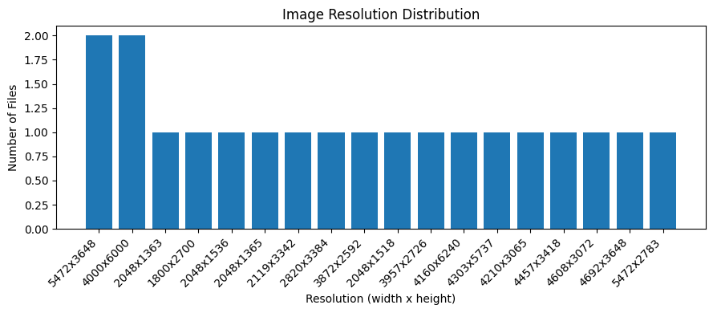
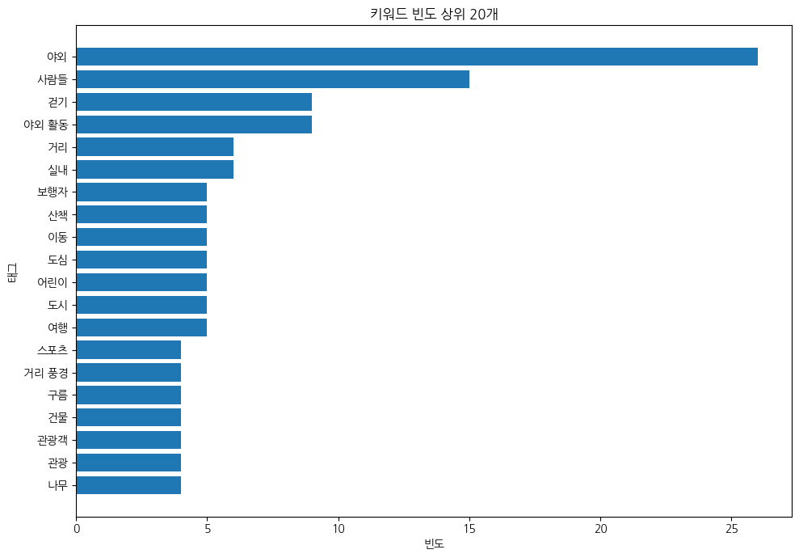
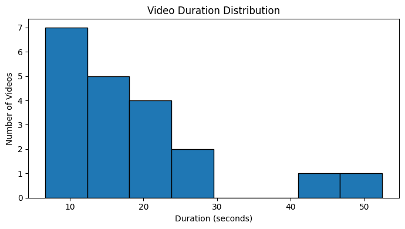
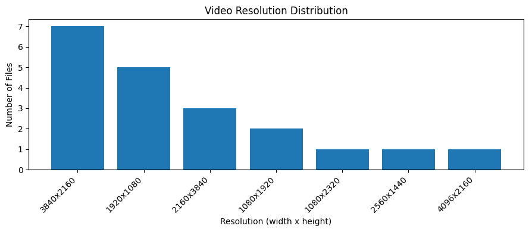

# Filename Rescue 평가 데이터셋

이 폴더는 [Filename Rescue](https://github.com/stella1298/filename-rescue)의 파일명 추출 및 메타데이터 분석 기능을 검증하기 위한 평가 데이터셋입니다. 이미지 20개, 동영상 20개와 파일별 정답 JSON 40개를 포함합니다.

이 데이터셋은 **모델 학습용이 아니라 평가 및 검증용**입니다. 파일명 구조대가 이미지와 동영상에서 추출한 키워드·근거·장소 정보를 정답 데이터와 비교하고, 변경 전후의 결과를 동일한 기준으로 확인하는 데 사용합니다.

## 폴더 구조

```text
evaluation/
├── images/                 # i01.jpg ~ i20.jpg
├── videos/                 # v01.mp4 ~ v20.mp4
├── answers/                # i01.json ~ i20.json, v01.json ~ v20.json
├── assets/                 # 평가 데이터 분석 그래프
└── manifest.json           # 새 ID, 원래 파일명, 해시, 길이, 관찰 시점 기록
```

이미지 `images/i01.jpg`의 정답은 `answers/i01.json`이며, 동영상 `videos/v01.mp4`의 정답은 `answers/v01.json`입니다. 이미지 파일은 `i01`–`i20`, 동영상 파일은 `v01`–`v20`으로 식별합니다. 기존 목록 순서로 번호를 부여했으며, 파일 하나당 정답 JSON 하나를 대응시켰습니다. 동영상 프레임은 평가 코드에서 추출합니다.

원래 파일명은 `manifest.json`의 `source_filename`에 기록했습니다. 평가용 ID를 부여하는 과정에서 원본 파일의 내용과 정답 내용은 변경하지 않았습니다. 매니페스트에는 해시, 길이 및 관찰 시점 정보도 기록되어 있습니다.

## 데이터 구성

| 구분 | 수량 | 형식 | 용도 |
|---|---:|---|---|
| 이미지 | 20개 | `.jpg` | 이미지의 키워드·근거·장소 추출 결과 검증 |
| 동영상 | 20개 | `.mp4` | 영상 프레임을 바탕으로 한 추출 결과 검증 |
| 정답 데이터 | 40개 | `.json` | 각 이미지·동영상의 예측 결과와 비교 |
| 매니페스트 | 1개 | `.json` | 새 ID와 원본 파일명, 해시 및 관찰 시점 확인 |

## 데이터 탐색 결과

아래 그래프는 평가 데이터의 기본적인 특성을 파악하기 위해 생성한 시각화 자료입니다. 그래프는 데이터 구성을 설명하기 위한 참고 자료이며, 그 자체가 모델 성능 평가 결과를 의미하지는 않습니다.

### 이미지 해상도 분포



이미지 샘플의 해상도별 파일 수를 나타냅니다. 여러 해상도의 이미지가 포함되어 있어 입력 이미지 크기의 다양성을 확인할 수 있습니다.

### 키워드 빈도 상위 20개



태그 분석에서 빈도가 높은 키워드를 보여줍니다. 그래프에서는 `야외`와 `사람들`이 상대적으로 높은 빈도를 보이며, 걷기·야외 활동·거리·실내 등 다양한 장면 관련 키워드가 나타납니다. 키워드 빈도는 데이터의 주제 분포를 살펴보는 데 활용할 수 있으며, 개별 태그의 정답 여부를 직접 나타내지는 않습니다.

### 동영상 길이 분포



동영상 샘플의 재생 시간 분포입니다. 짧은 영상이 다수이며, 40초 이상인 상대적으로 긴 영상도 포함되어 있어 길이가 다른 영상에서의 처리 결과를 점검할 수 있습니다.

### 동영상 해상도 분포



동영상 샘플의 해상도별 파일 수를 나타냅니다. 서로 다른 입력 해상도에서 프레임 추출 및 후속 분석이 가능한지 확인할 때 참고할 수 있습니다.

## 정답 JSON 형식 및 수정 방법

각 정답 JSON에는 다음 세 항목이 있습니다.

- `keywords`: 화면에서 관찰되는 대상·활동·배경과 허용할 동의어입니다. 개수 제한은 없으며, 모델 출력의 최대 5개 제한과는 별개입니다.
- `reason`: 태그를 뒷받침하는 관찰 근거와 주요 행동 변화입니다. 1~120자로 작성합니다.
- `place_name`: 화면에서 정확한 고유 지명을 확인할 수 있을 때만 작성합니다. 확실하지 않으면 `null`로 지정합니다.

현재 정답에는 파일당 약 31~40개의 허용 태그가 포함되어 있습니다. 예를 들어 `등산 스틱·트레킹 폴·등산 지팡이`, `물안경·수경·수영 고글`처럼 동의어와 표현 변형을 함께 포함할 수 있습니다. 공백만 다른 표현은 중복으로 추가하지 않았습니다. 태그 수는 정답 개수 목표나 모델 출력 개수를 의미하지 않습니다.

### 정답 데이터의 검수 상태

태그는 AI assistant가 파일별 이미지 및 영상 프레임의 내용을 확인해 작성한 **초안**입니다. 모든 순간이나 음성을 전부 검토해 확정한 정답은 아닙니다. 따라서 평가에 사용하기 전에 팀에서 원본 이미지와 영상 전체를 검토하고, 태그·근거·장소 정보를 수정해야 합니다.

팀의 사람이 해당 파일을 실제로 검수한 경우에만 `manifest.json`에서 다음 값을 갱신합니다.

- `human_reviewed`: `true`
- `annotation_status`: `reviewed`

검수하지 않은 파일을 검수 완료로 표시하지 마세요. 실제 확인한 시각은 각 파일의 `observed_timestamps_s`에 기록했습니다.

허용 태그 일치율은 참고 지표로 사용하고, 최종 품질은 사람이 결과의 정확성과 파일명으로서의 활용도를 함께 평가합니다. 비교 실험을 시작하기 전에 정답을 확정하고, 모든 실험 조건에서 같은 정답 버전을 사용하세요.

## 데이터 목록

### 이미지

`images/i01.jpg`부터 `images/i20.jpg`까지 총 20개 파일이 있습니다. 대표 주제에는 등산, 쇼핑, 공연, 카지노, 사막, 습지 등이 포함됩니다. 각 이미지의 세부 정답은 `answers/i01.json`부터 `answers/i20.json`에서 확인할 수 있습니다.

### 동영상

| 파일 | 길이(초) | 대표 태그 |
|---|---:|---|
| `v01.mp4` | 6.76 | 등산, 산행, 트레킹 |
| `v02.mp4` | 15.70 | 공항, 공항 터미널, 수하물 수취대 |
| `v03.mp4` | 18.60 | 지하철, 전철, 열차 |
| `v04.mp4` | 6.63 | 줄다리기, 줄다리기 경기, 체육대회 |
| `v05.mp4` | 25.14 | 놀이공원, 유원지, 회전목마 |
| `v06.mp4` | 15.59 | 시장, 재래시장, 노천시장 |
| `v07.mp4` | 8.68 | 스키, 스키 타기, 스키장 |
| `v08.mp4` | 25.16 | 자전거, 자전거 타기, 밸런스 바이크 |
| `v09.mp4` | 11.00 | 수영, 수영장, 실내 수영장 |
| `v10.mp4` | 11.52 | 요리, 요리사, 셰프 |
| `v11.mp4` | 23.33 | 고양이, 반려묘, 반려동물 |
| `v12.mp4` | 22.08 | 자전거, 자전거 타기, 라이딩 |
| `v13.mp4` | 15.36 | 파티, 실내 파티, 축하 모임 |
| `v14.mp4` | 8.87 | 화이트보드, 보드 필기, 필기 |
| `v15.mp4` | 10.01 | 놀이공원, 유원지, 놀이기구 |
| `v16.mp4` | 42.65 | 서핑, 파도타기, 서핑 보드 |
| `v17.mp4` | 52.48 | 피크닉, 소풍, 나들이 |
| `v18.mp4` | 16.02 | 농구장, 농구, 스포츠 |
| `v19.mp4` | 16.52 | 패러글라이딩, 액티비티 |
| `v20.mp4` | 18.02 | 보트 투어, 해양 레저 |

위 길이는 데이터 목록에 기록된 값입니다. 영상별 정답은 `answers/v01.json`부터 `answers/v20.json`에서 확인할 수 있습니다.

## 평가 코드에 연결하기

평가 코드는 [filename-model-quality-bench](https://github.com/yooongZa/filename-model-quality-bench) 저장소를 사용합니다. 해당 저장소에서 이 저장소의 `evaluation` 폴더를 데이터 루트로 지정합니다.

예시:

```bash
python a_quality.py \
  --dataset-root ../filename-rescue_fork/evaluation \
  --frames all \
  --dry-run
```

위 명령은 `filename-model-quality-bench` 폴더에서 실행하는 예시입니다. 실제 로컬 폴더 이름과 상대 경로에 맞게 `--dataset-root` 값을 조정하세요.

`--dry-run`은 원본 이미지와 영상에서 프레임을 준비하고 입력 파일 및 요청 수를 검사하는 단계입니다. 모델을 다운로드하거나 실제 추론을 실행하지 않습니다. 생성되는 `.filename_frames/` 캐시는 Git에 커밋하지 않도록 제외합니다.

### Google Colab에서 사용하기

1. `evaluation/` 폴더를 `evaluation.zip`으로 압축합니다.
2. ZIP 파일을 Google Drive의 `filename/datasets/`에 업로드합니다.
3. Colab에서 압축을 해제하고 평가 코드의 데이터 루트를 해당 `evaluation` 폴더로 지정합니다.
4. 이미지와 영상 사이에서도 확장자를 제외한 파일명이 중복되지 않는지 확인합니다.

## 검증 범위 및 한계

데이터 준비 단계에서 이미지 20개, 영상 20개와 JSON 40개의 일대일 대응, JSON 필드·자료형·태그 중복·근거 길이, 원본 복사본의 SHA-256 해시 일치를 확인했습니다. 기존 평가 코드의 `--frames all --dry-run`에서 파일 40건을 정상 인식했으며, **실제 모델 추론은 실행하지 않았습니다.**

따라서 현재 확인된 것은 데이터 파일 구성과 평가 입력 준비 단계의 정상 여부입니다. 모델의 파일명 생성 정확도나 최종 품질이 검증되었다는 의미는 아닙니다.

## 관련 저장소

- [Filename Rescue — 메인 프로젝트](https://github.com/stella1298/filename-rescue)
- [filename-model-quality-bench — 평가 코드](https://github.com/yooongZa/filename-model-quality-bench)

**Based on:** LMS Dataset 예제를 확인했으나 이 데이터 및 정답 파일 배치에 직접 대응하지 않아, 기존 filename 평가 코드의 입력 규약을 따랐습니다.
